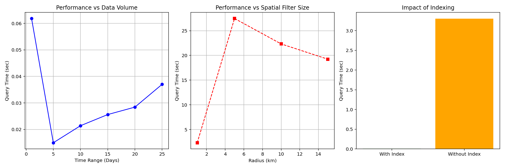

# MARITIME BIG DATA ANALYTICS SYSTEM (MongoDB & Python)
**Scalable Spatio-Temporal Database for AIS & Weather Data**

## 1. PROJECT OVERVIEW
This project implements a comprehensive Big Data management system for the maritime industry, developed as part of the Big Data and Analytics postgraduate program at the **University of Piraeus**. It combines ship movement data (AIS) with meteorological data (NOAA Weather Data) in a highly scalable NoSQL database (MongoDB).

**Main Features:**
* **Spatio-temporal Enrichment:** Linking ship positions with weather metrics (Wind, Temperature, Pressure) via a 3-step Spatio-Temporal Join.
* **Bucket Pattern Schema:** Grouping GPS points per 6-hour intervals to drastically optimize storage and indexing.
* **Containerization:** Fully portable environment using Docker and Docker Compose.
* **Advanced Analytics:** In-database calculation of performance metrics and complex trajectories (e.g., Tortuosity Index).

## 2. DATA SOURCES
* **AIS Dynamic & Static Data:** Containing ~8 million trajectory records (August 2017) and vessel metadata.
* **NOAA Weather Data:** Environmental Shapefiles (TMP, PRMSL, RH, WSPD).

## 3. PROJECT STRUCTURE
```text
/ROOT
  |-- docker-compose.yml        # MongoDB startup configuration (Port 27018)
  |-- requirements.txt          # Required Python libraries
  |-- README.md                 # This file
  |
  |-- [src] 
  |    |-- etl_process.py            # Main loading & enrichment script (ETL)
  |    |-- questions_queries.py      # Analytics queries (Descriptive & Geospatial)
  |    |-- benchmark_experiments.py  # Performance experiments
  |    |-- tortuosity.py             # Trajectory tortuosity index calculation
  |
  |-- [data] 
  |    |-- ais_data.csv              # Raw AIS data (Download from external link)
  |    |-- ais_static/               # Static ship details (CSV)
  |    |-- noaa_weather/             # Weather shapefiles
  |
  |-- [docs] 
       |-- Technical_Report.pdf      # Detailed Technical Report
       |-- Project_Presentation.pptx # Project Presentation
       |-- benchmarks.png            # Visualized performance results
```

## 4. PREREQUISITES & INSTALLATION
1. **Docker Desktop** (Installed and running).
2. **Python 3.10+** (To execute the scripts).
3. **Data Download:** Place the required datasets in the `data/` directory. *(Note: Raw data files are excluded from this repository due to size limits).*

**Start the Database:**
```bash
docker-compose up -d
```

**Install Python Dependencies:**
```bash
pip install -r requirements.txt
```

**Run Data Loading (ETL Process):**
```bash
python src/etl_process.py
```

## 5. SYSTEM BENCHMARKS
The architecture achieves linear scalability and a **~6:1 compression ratio** using the WiredTiger storage engine. Spatial querying and Hashed Indexing provide up to a **57x speedup** compared to full collection scans.



## 6. FUTURE WORK
As documented in the technical report, potential expansions include:
* **Real-time Streaming:** Integrating Apache Kafka and Spark Streaming for live AIS monitoring.
* **Machine Learning:** Predicting Estimated Time of Arrival (ETA) based on weather conditions and anomaly detection for illicit activities.
* **Visualization Dashboard:** Building an interactive Web UI using Leaflet/Mapbox for dynamic trajectory mapping.

## 7. AUTHOR
* **Christos Tsamis** 
* **Institution:** University of Piraeus, Department of Digital Systems

## 8. LICENSE
Distributed under the MIT License. See `LICENSE` for more information.
